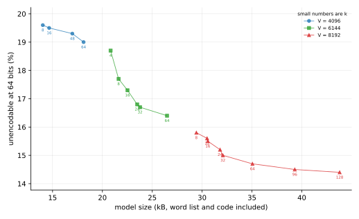
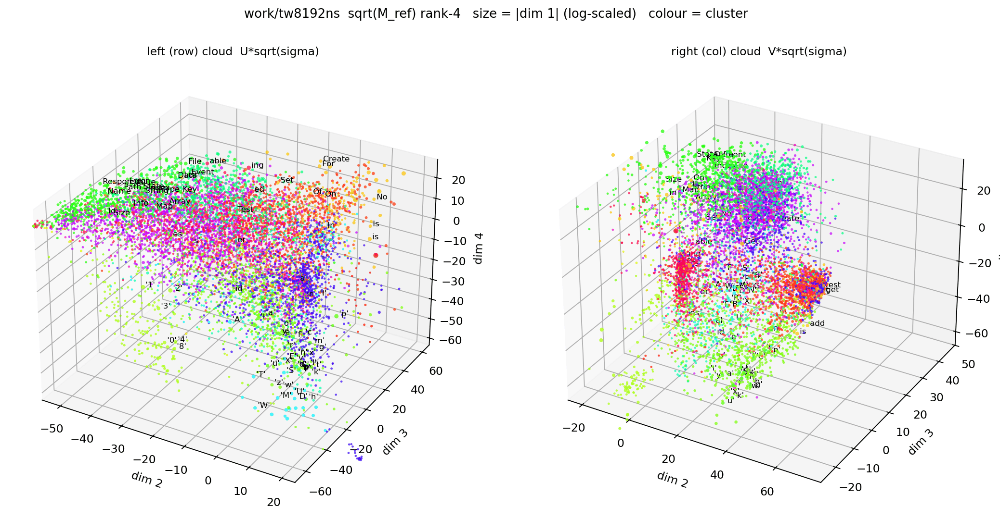

# varnames — a model of programming-language identifiers

**Goal.** Construct a **bijection from programming-language identifiers to the
integers**, one that can be *expressed compactly* — on the order of 20 KB
**total**, counting the code *and* its tables together. A 64-bit hash function
is usable as a bijection in practice, but its *inverse* is far too large; so
instead we are trying to build a **compression algorithm** that encodes an
identifier as an integer and can recover it.

**Status.** A *feasibility study* and an *experimental statistical exploration*:
the corpus, the models and the reports below exist to test whether a compact
bijection is reachable at all. This is research, not yet a finished codec.

What is reachable today: the best model we have codes held-out identifiers at
**45.2 bits**, fits **85.0%** of them in 64 bits and **99.0%** in 128 bits, for a
model file of **30,745 bytes** (32.8 kB with the library code) at 8192 words and
32 clusters. That is short of the 20 kB goal, and the gap is where the remaining
research sits — the measured frontier, and what it costs to move along it, is in
[`docs/MODEL_BUDGET.md`](docs/MODEL_BUDGET.md) and
[`docs/ENCODING.md`](docs/ENCODING.md). Every figure is measured from a packed
model file by `scripts/model_size.py`.

## The product

The goal is to provide a library to encode identifiers into integers and decode
them again. Integers are much more efficient to process than strings, and more
compact, so a bijective map between them would be useful. We propose to specify
a portable (cross-language) standard for the encoding, and to ship
implementations of it. The long-term scope, audiences and design intent are in
[`docs/PRODUCTISATION.md`](docs/PRODUCTISATION.md).

The library works with CamelCase identifiers, containing only letters, digits,
and underscores. We ship functions to convert identifiers between different
capitalisation conventions, and using those we can also encode lower_case and
UPPER_CASE identifiers efficiently too (the rules, and the measured benefit, are
in [`docs/CASE_NORMALISATION.md`](docs/CASE_NORMALISATION.md)). This covers the
majority of programming use cases. The original capitalisation convention is not
encoded; it is the caller's responsibility. The encoding is otherwise lossless.

We target two fixed budgets: 64-bit integers and 128-bit integers.
Exceptionally long or rare identifiers do not fit in the budget; it is left to
the caller to decide how to handle these cases. We think it would be sensible to
reject them, or to encode them using a hash function and decode them using a
hash map. The 64-bit budget is a little restrictive: at the current operating
point about one identifier in six cannot be encoded, though they tend to be
pretty ugly ones. The 128-bit budget is enough for almost any identifier. Both
figures are measured on held-out identifiers, and what the sets contain, where
the length boundary falls and what kind of name fails are in
[`docs/BUDGET64_STUDY.md`](docs/BUDGET64_STUDY.md).

Compressing long identifiers into small integers is an exercise in information
theory. The bulk of the work is statistics, not programming. What you will find
in this repo are the tools we used to study the statistics and to come up with a
simple, compact model that can form the basis of the standard.

The model itself is a portable file, versioned and human-readable, whose format
is specified in [`docs/MODEL_FORMAT.md`](docs/MODEL_FORMAT.md). The standard the
file serves is proposed in [`docs/STANDARD.md`](docs/STANDARD.md), and there are
two implementations of it: a reference one in [`python/`](python/) and an
engineering one in [`rust/`](rust/), both defaulting to the published tables and
both accepting others.

## The strategy

The experimental strategy is as follows:

- **Build a corpus** — harvest identifiers from ten ecosystems and union them;
  see [`docs/CORPUS.md`](docs/CORPUS.md).
- **Case-normalise it** — split into lower_case / UPPER_CASE / CamelCase,
  convert the first two to CamelCase, merge and de-duplicate. On the current
  union that is 4,441,974 identifiers in, 4,226,707 out; normalisation makes
  even the untouched CamelCase identifiers 3.5 bits shorter. See
  [`docs/CASE_NORMALISATION.md`](docs/CASE_NORMALISATION.md).
- **Build word lists** — the "words" the model is made of. The adopted word
  list is a **pair-merge dictionary**: start from the character alphabet and
  greedily merge the most frequent adjacent pair, so that every word is a
  pair of two earlier words. The decoder can replay the rules.
  See [`docs/DICTIONARY_RULES.md`](docs/DICTIONARY_RULES.md) for the rule
  choice, [`docs/TREE_WORDS.md`](docs/TREE_WORDS.md) for the dictionary model
  and the merge theory, and [`docs/PRUNE_WORDS.md`](docs/PRUNE_WORDS.md) for
  the (unsuccessful) attempt to prune the list after the fact.
- **Measure statistics** — count word × word adjacencies over the whole corpus
  and smooth them with a shared prior of strength `κ`. See
  [`docs/ADJACENCY_MATRIX.md`](docs/ADJACENCY_MATRIX.md); the
  [`docs/STRUCTURAL_ZEROS.md`](docs/STRUCTURAL_ZEROS.md) note records why the
  prior's structural zeros can be ignored.
- **Cluster words with similar statistics** — It is cheaper to store a
  cluster × cluster adjacency matrix than a word × word matrix. See
  [`docs/CLUSTER_WORDS.md`](docs/CLUSTER_WORDS.md), with
  [`docs/CLUSTER_LOSS.md`](docs/CLUSTER_LOSS.md) for where the loss lives and
  [`docs/SHARED_CLUSTERS.md`](docs/SHARED_CLUSTERS.md) for using one cluster
  assignment on both sides.
- **Build a cheap model of the probability distributions** — price the word
  list, the tables and the code in bytes, and find the size that buys the most
  fit. See [`docs/MODEL_BUDGET.md`](docs/MODEL_BUDGET.md) and
  [`docs/WORDLIST_BUDGET.md`](docs/WORDLIST_BUDGET.md).
- **Build an encoder based on the model** — Huffman over the cluster and word
  steps, with a zero-weight stop to end the cycle for free. See
  [`docs/ENCODING.md`](docs/ENCODING.md); the cost of the Huffman restriction
  itself, and of the tokenisation, is in
  [`docs/CODING_OVERHEAD.md`](docs/CODING_OVERHEAD.md) and
  [`docs/TOKENISATION.md`](docs/TOKENISATION.md).

It is important that the model is small and efficient, otherwise nobody will want
to use it. The pertinent optimisation criterion is the fraction of identifiers
in the training corpus that fit in 64 bits, measured as a function of the model
size. With a large model we could do much better, but that's not the point; the
question is how well we can do with a small model. The fit rate is measured on
held-out identifiers ([`docs/BUDGET64_STUDY.md`](docs/BUDGET64_STUDY.md)) and
systematically compared by measured model size
([`docs/MODEL_BUDGET.md`](docs/MODEL_BUDGET.md)). Fitting an additional 1% of
identifiers into 64 bits seems to cost between 1K and 6K in the interesting
model size range; it costs more for larger models.



The figure plots the frontier table in
[`docs/MODEL_BUDGET.md`](docs/MODEL_BUDGET.md) §6: model size against the fraction
of held-out identifiers that do *not* fit in 64 bits, so the best model is
furthest bottom-left. Filled points are the measured packed files, one curve
per word list (the small numbers are `k`); the hollow diamonds charge the
library code as well, so they sit to the right of their model-only points.

We tried two main strategies, and found that the second one is much better:

- Rejected: encode each character conditionally on the context that precedes it
  — the longest-suffix **successor model**. See
  [`docs/SUCCESSOR_MODEL.md`](docs/SUCCESSOR_MODEL.md) and the character-level
  fixed-budget numbers in [`docs/CODE_LENGTHS.md`](docs/CODE_LENGTHS.md).
- Adopted: tokenise the string into words, and define a **Markov model on the
  words**. See [`docs/WORD_COMPRESSIBILITY.md`](docs/WORD_COMPRESSIBILITY.md).

In the above, "word" means any string that is commonly used in identifiers; many
are in fact English words or abbreviations but many are not.

We explored many ways of defining "word". It turns out that the list of words is
the most important part of the model, and it therefore accounts for the majority
of the model size — two thirds of the shipped file, 20,926 of 30,745 bytes at
the operating point. See ([`docs/WORDLIST_BUDGET.md`](docs/WORDLIST_BUDGET.md))
for details of the compromise. The best idea for the rejected strategy was
different from the best idea for the adopted strategy (cited above).

In both strategies, we found that there is a huge benefit from clustering words
with similar statistics. This reduces the model size a lot, but worsens
compression only a little: in the word model the `V × V` table shrinks to
0.03–0.07% of its cells for 7–9 bits per identifier
([`docs/CLUSTER_WORDS.md`](docs/CLUSTER_WORDS.md)), and in the character model a
few hundred clusters come within a fraction of a bit of its exact-context bound
([`docs/SUCCESSOR_MODEL.md`](docs/SUCCESSOR_MODEL.md)).



The figure is the word table seen as two clouds. It is the rank-4 square-root
factorisation of the table
([`docs/HELLINGER_FACTORISATION.md`](docs/HELLINGER_FACTORISATION.md)), so every
word has a *row* coordinate (left panel) and a *column* coordinate (right
panel). Each panel plots latent dimensions 2–4, divided by the square root of
the word's unigram probability, which removes the mass trend and leaves the
angular structure the clustering works on; a point's size is `|dim 1|` and its
colour is the **right cluster** the shipped model assigns it to, which is also
its left cluster because the assignment is shared.

What to look for is that one assignment produces *regions* rather than confetti
in both panels — green upper left, the magenta-and-red band, orange at the right
edge of the left cloud; red in a lobe of its own, purple and cyan above, green
below in the right one. The 100 most massive words are labelled, and they are
what makes the regions readable: `Response`, `FileName`, `Name` and `Key` in the
green upper left, `Create`, `For`, `Set` and `Is` at the orange right edge,
`Statement`, `OnError` and `Value` in the purple band of the right cloud. A
single table of relationships, read from both sides, is what buys that.

The tool is `scripts/factor_cloud.py --dir work/tw8192ns --model
standard/model.nvm1 --divide-unigram --no-cluster-labels`; a fresh clustering
can be computed on the spot with `--clusters K`, and the CSV it writes carries
the cluster so the plot can be redrawn elsewhere.

Along the way, we tried a lot of things that didn't work:

- **Runs as words.** A rule that merges a character with a copy of itself, to
  absorb `ooo`-style padding cheaply. Forbidden outright: at the vocabularies in
  use it costs nothing to drop it, and the run machinery is dropped with it
  ([`docs/DICTIONARY_RULES.md`](docs/DICTIONARY_RULES.md),
  §"Removing run words altogether").
- **Boundary words.** Adding `v\n` as a dictionary word so the model can see
  the end of the identifier as a token. Worth ~1% of the held-out bits; not
  worth the table ([`docs/BOUNDARY_TRIGRAM.md`](docs/BOUNDARY_TRIGRAM.md)).
- **A reserved cluster for the stop token.** Cheap to reserve, but inert
  ([`docs/NEWLINE_CLUSTER.md`](docs/NEWLINE_CLUSTER.md)).
- **Overshoot-and-prune the word list.** Build a bigger list, then remove the
  words whose removal saves the most. It wins on the unclustered model and
  loses 1–2 bits on the clustered one
  ([`docs/PRUNE_WORDS.md`](docs/PRUNE_WORDS.md)).
- **Breaking open the pair.** A structured back-off prior for the word
  bigrams. Loses to the plain marginal prior
  ([`docs/BREAK_OPEN_PRIOR.md`](docs/BREAK_OPEN_PRIOR.md)).
- **Coding the matrix directly.** Top-`N` cells over a low-rank fit, instead
  of a block model. Beaten at matched store
  ([`docs/MATRIX_COMPRESSION.md`](docs/MATRIX_COMPRESSION.md)).
- **The square-root (Hellinger) factorisation of the table.** 3.5–4 bits behind
  co-clustering at equal store
  ([`docs/HELLINGER_FACTORISATION.md`](docs/HELLINGER_FACTORISATION.md)).
- **Arithmetic coding.** The obvious alternative to Huffman encoding. Bits are
  level within about a bit, and the Huffman code has the smaller model size
  ([`docs/CODING_OVERHEAD.md`](docs/CODING_OVERHEAD.md),
  [`docs/MODEL_BUDGET.md`](docs/MODEL_BUDGET.md) §5.2).
- **Cluster quarters (`q > 1`).** Splitting each left cluster's tree into `q`
  right clusters buys 0.1 bits and 0.1 fit points for 1.2 kB once the
  terminator is free, so `q = 1` ships
  ([`docs/CLUSTER_QUARTERS.md`](docs/CLUSTER_QUARTERS.md)).
- **Combining the rule pair into one number.** Triangle and Square pack
  `(u, v)` into a single index; both lose to coding the two child ids
  separately, because the skew the code exploits is per child
  ([`docs/RULE_ENCODING.md`](docs/RULE_ENCODING.md)).

## Layout

```
varnames/
├── corpus/
│   ├── identifiers.multilang.txt        # union of all 10 ecosystems (4,441,974)
│   └── by_language/
│       ├── ruby.txt  rust.txt  ocaml.txt  haskell.txt  java.txt
│       ├── python.txt  go.txt  lua.txt  perl.txt  javascript.txt
├── PLAN.md                              # index of the research lines (+ long-term productisation horizon)
├── LICENSE-MIT  LICENSE-APACHE          # code + specification: MIT OR Apache-2.0
├── LICENSE-CC0                          # corpus + published tables: CC0-1.0
├── docs/
│   ├── CORPUS.md                        # corpus statistics + reproduction
│   ├── CASE_NORMALISATION.md            # case normalisation + common substrings
│   ├── ADJACENCY_MATRIX.md              # building the word matrix + the κ prior
│   ├── DICTIONARY_RULES.md              # building the dictionary: rule choice, Δ vs frequency
│   ├── TREE_WORDS.md                    # dictionary model + merge theory (§9)
│   ├── PRUNE_WORDS.md                   # overshoot/prune the word list (unsuccessful)
│   ├── WORDLIST_BUDGET.md               # word list vs table: where the model budget goes
│   ├── SUCCESSOR_MODEL.md               # the rejected strategy: character model + its size frontier
│   ├── CODE_LENGTHS.md                  # character-model fixed-budget compressibility
│   ├── WORD_COMPRESSIBILITY.md          # the word model's held-out 64/128-bit fit
│   ├── HELLINGER_FACTORISATION.md       # square-root factorisation of the word matrix
│   ├── MATRIX_COMPRESSION.md            # direct coding of the word matrix (residual + top-N)
│   ├── STRUCTURAL_ZEROS.md              # structural zeros of the word prior (negligible)
│   ├── CLUSTER_WORDS.md                 # co-cluster the word matrix to compress it
│   ├── CLUSTER_LOSS.md                  # where the co-clustering loss lives + block structure
│   ├── SHARED_CLUSTERS.md               # one cluster assignment for both sides
│   ├── BREAK_OPEN_PRIOR.md              # structured back-off prior; loses to P_mar
│   ├── BOUNDARY_TRIGRAM.md              # boundary words (v\n) are worth ~1% held-out
│   ├── NEWLINE_CLUSTER.md               # reserved cluster for the stop token (rejected)
│   ├── CODING_OVERHEAD.md               # words per identifier + Huffman vs arithmetic
│   ├── RUN_LENGTHS.md                   # typical run lengths (maximal repeated-character runs)
│   ├── MODEL_BUDGET.md                  # model size in bytes, word list included
│   ├── MODEL_FORMAT.md                  # the portable YAML model + its binary form
│   ├── RULE_ENCODING.md                 # encoding the rule list: the pair/code grid
│   ├── frontier.svg                     # the size-versus-fit scatter plot
│   ├── factor-cloud.png                 # the words as two clouds, coloured by cluster
│   ├── BUDGET64_STUDY.md                # the 64-/128-bit identifier sets
│   ├── ENCODING.md                      # the encoding: stop token, published tables
│   ├── STANDARD.md                      # the proposed standard: code, sets, tables
│   ├── CLUSTER_QUARTERS.md              # the quarter code: q right clusters per left
│   ├── CODESIGN.md                      # codesign the assignment and the code (a sketch)
│   ├── TOKENISATION.md                  # tokeniser speed: precedence vs bucket parser
│   ├── SMALL_DICT.md                    # the V=512 testing vocabulary: what it can and cannot show
│   └── PRODUCTISATION.md                # long-term: design intent, scope, audiences (draft)
├── scripts/
│   ├── extract.py                       # streaming regex tokeniser (memory-bounded)
│   ├── audit_extract.py                 # check the scrubber against real source trees
│   ├── check_extract.py                 # regression cases for the scrubber
│   ├── fetch_gems.py                    # parallel RubyGem downloader
│   ├── harvest_packages.py              # download plan + unpack for Java/Haskell/OCaml/Lua
│   ├── unpack_gems.py                   # .gem → source tree
│   ├── stats.py                         # corpus statistics → Markdown
│   ├── validate_corpus.py               # sorted/unique/ASCII + artefact check
│   ├── classify_identifiers.py          # lower_case / UPPER_CASE / CamelCase split
│   ├── camelize_identifiers.py          # snake_case → CamelCase conversion
│   ├── merge_identifiers.py             # merge the three lists, de-duplicate
│   ├── common_substrings.py             # ^id$ substrings occurring ≥ N times
│   ├── run_camel_pipeline.sh            # run the four steps end to end
│   ├── h5_build.sh                      # rebuild the grid dictionaries + adjacency
│   ├── split_corpus.py                  # deterministic 9:1 train/validation split
│   ├── winhash.py                       # 64-bit rolling-hash helpers (library)
│   ├── successor_distributions.py       # P(next character | common substring)
│   ├── code_lengths.py                  # character model: ideal length + 64/128-bit fit
│   ├── cluster_substrings_lib.py        # K-means helpers (library)
│   ├── cluster_substrings.py            # CLI: K-means on the Hellinger embedding
│   ├── cluster_entropy.py               # successor entropy (bits) per cluster
│   ├── cluster_size_frontier.py         # (model size, entropy) frontier + k/N
│   ├── symmetry_check.py                # left/right reversal-symmetry sanity check
│   ├── pair_matrix_lib.py               # word adjacency M + SVD/NMF helpers (library)
│   ├── pair_matrix.py                   # CLI: build adjacency M + low-rank factors
│   ├── choose_kappa.py                  # choose the prior strength κ by held-out likelihood
│   ├── tree_words.py                    # dictionary (pair merge) + word × word adjacency model
│   ├── check_tree_words.py              # regression test for the dictionary + tokeniser
│   ├── check_merge_delta.py             # regression test for the merge delta
│   ├── word_build_rescan.py             # time/verify the rescan dictionary builder
│   ├── token_cache.py                   # cache a tokenised corpus for a dictionary
│   ├── tokenizer_bench.py               # tokeniser speed / equivalence benchmark
│   ├── hfactor_words.py                 # Hellinger factorisation + structural zeros
│   ├── prune_words.py                   # overshoot-and-prune the word list by removal cost
│   ├── cluster_words.py                 # K-means co-clustering of the word matrix
│   ├── codesign.py                      # assignment vs code term at a matched k (a negative)
│   ├── cluster_loss_attribution.py      # attribute the assoc loss to cluster-pair cells
│   ├── block_structure.py               # rank/sparsity of a high-loss cluster-pair block
│   ├── matrix_compress.py               # direct compression of the matrix (residual + top-N)
│   ├── factor_cloud.py                  # 3D cloud viz of the rank-4 sqrt factorisation
│   ├── shape_gain_test.py               # test the cloud "gain × shape" factorisation vs nulls
│   ├── wordlist_budget.py               # word-list size vs k² table budget
│   ├── words_per_identifier.py          # token-count histogram + Huffman penalty
│   ├── model_budget.py                  # model size in bytes (word list + tables)
│   ├── model_size.py                    # the size oracle: pack, decode, price the model
│   ├── rule_encoding.py                 # the rule-pair encoding grid (docs/RULE_ENCODING.md)
│   ├── depth_bias.py                    # why the depth bias is searched, not computed
│   ├── frontier_plot.py                 # draw docs/frontier.svg from the frontier table
│   ├── wordlist_order.py                # creation order vs unigram order in a built list
│   ├── model_fit_rates.py               # held-out fit rates; cost of quantising the tables
│   ├── k_frontier.py                    # the bytes-for-fit frontier as a curve
│   ├── budget64_study.py                # 64/128-bit sets (arithmetic account; superseded)
│   ├── budget64_sets.py                 # 64/128-bit sets through the packed model
│   ├── build_standard_model.py          # build the one standard model + its digest
│   ├── case_ablation.py                 # case-normalisation ablation (paired CamelCase test)
│   ├── break_open_prior.py              # break-open prior vs P_mar on held-out data
│   ├── boundary_trigram.py              # bits the boundary trigram (u,v,\n) is worth
│   ├── run_lengths.py                   # run-length statistics of the corpus
│   ├── word_runs.py                     # word-level runs (repeated words, not characters)
│   ├── dict_experiments.py              # dictionary rules: run words, Δ vs frequency
│   ├── shared_clusters.py               # one cluster assignment for both sides
│   ├── newline_cluster.py               # reserve a cluster for the stop token
│   ├── quarter_accounting.py            # price the quarter code layouts exactly
│   ├── quarter_codes.py                 # build the quarter codes and score them held-out
│   ├── c26_closeout.py                  # shared-clusters close-out vs the interpolated frontier
│   ├── run_sweep.sh                     # run the analyses over all thresholds
│   └── run_break_open_prior.sh          # run the break-open-prior sweep
├── python/                              # reference implementation, runnable and readable
│   ├── pyproject.toml                   # packaging; `varnames` console script
│   ├── README.md                        # the API, the CLI, the sets
│   ├── varnames/                        # bitio, ladder, model, codec, standard, cli
│   │   └── data/model.nvm1              # the standard tables, 30,745 B, digest-checked
│   └── tests/                           # unit tests + the held-out rate test
├── rust/                                # engineering implementation, no dependencies
│   ├── Cargo.toml                       # no dependencies, no build script
│   ├── README.md
│   ├── src/                             # bitio, ladder, model, codec, standard, sha256
│   │   └── bin/varnames.rs              # the CLI
│   ├── data/model.nvm1                  # the same tables, compiled in
│   └── tests/golden.txt                 # 250 identifiers + codes, read by both ports
├── standard/
│   ├── model.nvm1                       # the published model file
│   └── model.yaml                       # its human-readable form (MODEL_FORMAT.md §2)
└── data/
    └── rubygems_versions.txt            # RubyGems compact index (regenerable)
```

### Working directories (gitignored, regenerable)

```
work/camel/         # case normalisation: lower/upper/Camel splits,
                    #   camel_from_lower/upper, merged.txt,
                    #   merged_training.txt + merged_validation.txt (9:1 split)
work/tw4096ns/      # pair-merge dictionary (V=4096) + cyclic bigram adj.npz
work/tw6144ns/      # the same at V=6144
work/tw8192ns/      # the same at V=8192
work/tw512ns/       # V=512: testing only, never a result (see docs/SMALL_DICT.md)
work/common<T>/     # common substrings (threshold T) + successor distributions
                    #   (500, 1000, 2000, 5000, 10000, 20000, 50000, 100000)
```

The `ns` suffix means *no stride*: the dictionary is built from a 5% sample of
the training lines (`--sample 20`) and the adjacency counted over all of them
(`--stride 0`). `tw6144ns` and `tw8192ns` are the other two points of the
canonical grid; the `s0` twins (`--sample 0 --stride 0`) exist to check that the
5% sample does not bias the dictionary. `tw96`, `tw2040`, `tw2040ns`, `tw4414`
and `tw11694` are pre-expansion or retired builds kept because reports still
quote them, and `tw4096raw` exists only for the case-normalisation ablation.
`work/` also holds the corpus-build intermediates
(`gems_dl/`, `*_src/`, `clean_ids/`, `*.shards`, per-ecosystem logs) — tens of
thousands of files and several GB, none of it tracked.

**Search with `rg` or `git grep`, never a bare `grep -r`.** `grep -r` ignores
`.gitignore`, so it walks the downloads and the multi-million-line corpora (and
this checkout lives on slow storage): the same query that takes seconds with
`rg` — which skips everything ignored, `work/` included — can run for minutes.
`git grep` is the right tool when only tracked files matter.

## Repository conventions

Four house rules keep the plan and the reports from drifting apart.

**Keep plan identifiers out of reports and filenames.** `PLAN.md` labels each
thread with a short identifier (`A1`, `B1`, `C5`, …). Those labels are *local to
the plan* — the plan is a living document, and a thread can be renumbered or
re-scoped, so any report that cites "C5" goes stale the moment it does.
Experiment reports (`docs/*.md`), filenames and code therefore refer to an
experiment by a **descriptive name** ("the break-open prior", "the pair-merge
dictionary"), never by its plan label. Plan identifiers appear only in
`PLAN.md`.

**`PLAN.md` is an index, not a report.** It records **execution status and
success/failure only** — one line per thread, plus a pointer to the report that
owns the detail. Design notes, derivations and experimental results do **not**
belong in `PLAN.md`; they live in the individual experiment reports, which
`PLAN.md` links to. This keeps the plan readable, and lets the reports evolve
without touching it.

**Nothing is decided at the testing vocabulary.** The pair-merge dictionary is
built at a fixed grid (`V = 4096, 6144, 8192`), and `V = 512` exists only to
exercise scripts: it builds in seconds and fits in memory, so a new harness can
be run end to end before the real one is paid for. It is **not** a small version
of the product. No accept/reject decision, no byte budget and no frontier price
may be taken from it — it is not the relevant part of the frontier. Measurements
at `V = 512` are kept in [`docs/SMALL_DICT.md`](docs/SMALL_DICT.md), which
carries the same warning; the experiment reports quote only the grid.

**Price a compression decision in fit rate, and in bytes.** A change can win on
mean bits and still be worthless: the product is a fixed-budget encoder, so what
matters is the fraction of identifiers that fits in 64 bits, and what that
fraction costs in kilobytes. Reports therefore quote bits **and** the fit rate,
and anything that trades one for the other is priced against the local frontier
slope in kB per point of fit.

## Licensing, provenance and authorship

Identifiers are extracted as facts from openly published package sources and
locally installed open-source software. Individual packages carry their own
licences. This repository contains only the derived token lists, not the
original source code.

The original work in this repo is offered under **MIT OR Apache-2.0**, at your
option ([`LICENSE-MIT`](LICENSE-MIT), [`LICENSE-APACHE`](LICENSE-APACHE)).
Both are permissive, so a standard defined here can be embedded in compilers,
editors and products without a licensing conversation; the Apache option adds an
express patent grant, which is why it is offered alongside the simpler MIT. The
dual form also matches the Rust ecosystem, where the engineering implementation
will be published.

The derived corpus and the published lookup tables are dedicated to the public
domain under **CC0-1.0** ([`LICENSE-CC0`](LICENSE-CC0)), to the extent we hold
rights in them. The point is that an implementation must be free to copy the
tables into its binary without an attribution burden — and to be used as
training or evaluation data — while the identifiers themselves remain facts
about third-party packages whose own licences are unaffected. (In the EU a
collection of identifiers could in principle attract database rights even
though the individual tokens are facts; the CC0 dedication covers whatever
rights we do hold.)

**Authorship.** The design, experiments and text were developed by Alistair
Turnbull in collaboration with an AI coding agent (goose, from the Agentic AI
Foundation). The agent wrote most of the code from the author's design and
instructions, and drafted most of the prose; the research direction, the choice
of experiments, the checking of every result and the responsibility for what is
published are human. This note is here so that the provenance is not a surprise
to a reader or to a downstream user, and so that the copyright, warranty and
patent terms above are understood to be asserted on the usual human-authorship
basis.

## Contributing

We welcome contributions on [GitHub](https://github.com/apt1002/varnames) and
you can email us at `varnames -at- minworks.co.uk`. Contributions are accepted
under the same terms as the project (inbound = outbound); no CLA is required.
